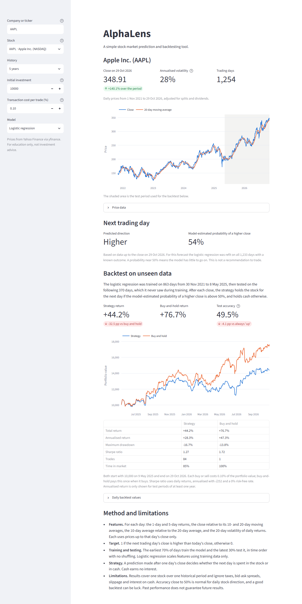

# AlphaLens

A simple stock market prediction and backtesting tool built with Python, scikit-learn and Streamlit.

AlphaLens downloads daily prices for a stock and trains a small machine learning model to predict whether the next trading day's close will be higher. It then backtests a strategy that trades on those predictions and compares it with simply buying and holding the stock.



*The running app for AAPL with five years of history and logistic regression, captured on 29 October 2026.*

## The question

**Can a simple machine learning model generate a trading strategy that outperforms buying and holding a stock after accounting for transaction costs?**

AlphaLens lets you test this for any ticker on Yahoo Finance. In the run shown above, the answer was no. The strategy returned +44.2% against +76.7% for buy-and-hold over the same 370-day test period. The model's test accuracy (49.5%) was below that of always predicting "up".

## Features

- Search by company name (for example Apple) or ticker symbol (for example AAPL), then pick from the matching stocks, ETFs and indices
- The company name is shown next to the ticker, for example "Apple Inc. (AAPL)"
- Daily prices for any Yahoo Finance listing (default AAPL), with 1, 2, 5 or 10 years of history
- Indicators: daily returns, 10- and 20-day moving averages, 20-day rolling volatility
- Two models: logistic regression and random forest
- Chronological train/test split, with accuracy reported only on unseen data and compared with a naive baseline
- Backtest with configurable starting capital and transaction costs, compared with buy-and-hold
- Metrics: total and annualised return, maximum drawdown, Sharpe ratio, number of trades, time in market
- Next-trading-day prediction with a model-estimated probability
- Clear messages for searches with no matches, failed downloads and short histories

## Tech stack

Python · Streamlit · yfinance · pandas · NumPy · scikit-learn · Plotly · pytest · GitHub Actions

## How it works

```text
app.py        Streamlit interface; calls the modules below
data.py       searches listings and downloads and cleans daily prices (yfinance)
features.py   indicators, model features and the next-day target
model.py      chronological split, training, evaluation and next-day forecast
backtest.py   strategy simulation, transaction costs and performance metrics
tests/        pytest suite on synthetic prices (no internet needed)
```

Data flows in one direction: **prices → features → model → backtest → dashboard**.

### Model

- **Target:** 1 if the next trading day's close is higher than today's close, otherwise 0.
- **Features:** 1-day and 5-day returns, the close relative to its 10- and 20-day moving averages, the 10-day average relative to the 20-day average, and 20-day volatility. Each feature uses only prices up to that day's close.
- **Split:** the earliest 70% of days train the model and the latest 30% test it, with no shuffling. Feature scaling for logistic regression is fitted on the training data only.
- **Models:** logistic regression, and a random forest of 200 shallow trees with a fixed random seed.

### Backtest

- After each close, the strategy holds the stock for the next day if the model-estimated probability of a higher close is above 50%. Otherwise it holds cash, which earns nothing.
- Every buy or sell costs the chosen percentage of portfolio value. The strategy starts in cash. Buy-and-hold pays the cost once when it buys.
- Both portfolios use the same test period and starting capital.
- The Sharpe ratio uses daily returns, annualised with √252 and a 0% risk-free rate. Annualised return is shown only for test periods of at least one year.

## Run locally

Requires Python 3.12 or newer.

```bash
git clone https://github.com/theguestgeorge/alphalens.git
cd alphalens
python -m venv .venv
source .venv/bin/activate        # Windows: .venv\Scripts\activate
pip install -r requirements.txt
streamlit run app.py
```

The app opens at http://localhost:8501. It needs no API keys or secrets.

## Tests

```bash
pytest
```

The tests use synthetic price series and need no internet connection. They check:

- indicator values
- alignment between the next-day target and the features
- that features never use future prices
- the chronological split, and that test-period outcomes cannot influence training
- signal timing in the backtest and how transaction costs are charged
- the performance metrics, on series with known answers
- filtering and ordering of search results
- handling of invalid, missing and insufficient data

GitHub Actions runs the suite on Python 3.12 and 3.13 for every push and pull request.

## Deploy to Streamlit Community Cloud

1. Sign in at [share.streamlit.io](https://share.streamlit.io) with your GitHub account.
2. Choose **Create app**, then deploy a public app from GitHub.
3. Set **Repository** to `theguestgeorge/alphalens`, **Branch** to `main`, and **Main file path** to `app.py`.
4. Under **Advanced settings**, choose Python 3.12 or 3.13. The pinned NumPy version needs 3.12 or newer.
5. Click **Deploy**. Dependencies install from `requirements.txt`, and no secrets are required.

## Limitations

- Results cover one stock over one historical period, using a single train/test split rather than repeated walk-forward testing.
- Taxes, bid-ask spreads, slippage and interest on cash are ignored.
- Daily stock direction is close to random, so accuracy near 50% is normal. A strategy that beats buy-and-hold in one backtest may simply have been lucky. Trying many tickers or settings and keeping the best result makes this more likely.
- Prices come from Yahoo Finance through the unofficial yfinance library. It can be rate-limited, change without notice, or contain errors.
- If downloads fail locally with an SSL certificate error, an antivirus program or proxy may be intercepting HTTPS. Set the `SSL_CERT_FILE` environment variable to a CA bundle that includes its root certificate.

## Disclaimer

AlphaLens is an educational project, not investment advice. Model probabilities are statistical estimates, not certainties, and past performance does not guarantee future results.
